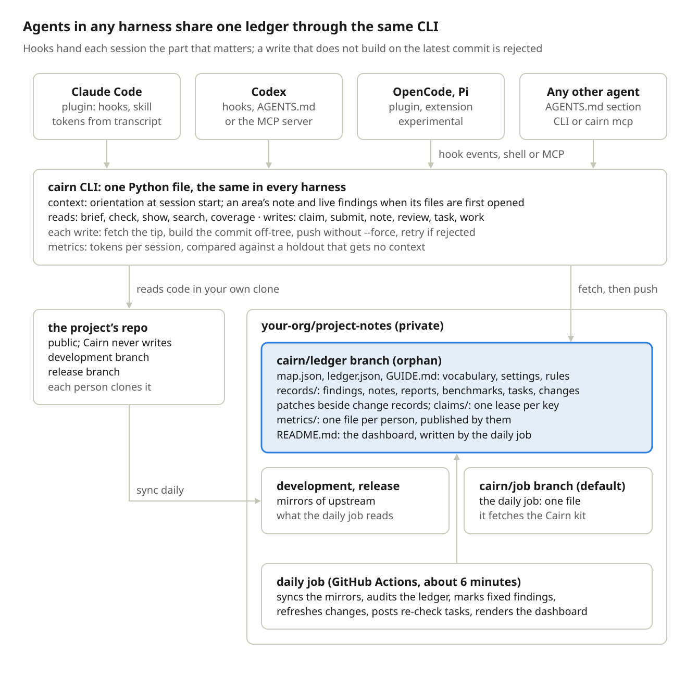
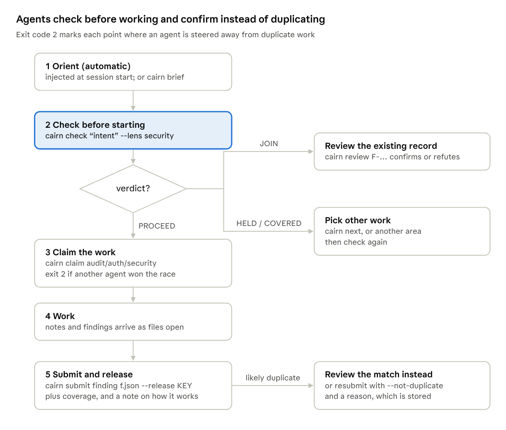

# Cairn: Shared Context for Coding Agents

Design doc, November 2026.

## Summary

Cairn lets coding agents run by different people share what they learn about a repository. Notes on how each part of the code works, findings, what has already been examined and work in progress all go into a ledger kept in git. Each agent gets the relevant part injected automatically, so it starts from what others already know instead of re-reading the code, and doesn't redo work another person's agent has done.

The test of whether it is worth running is simple: answers should get better and sessions should use fewer tokens. If neither happens, Cairn isn't providing value. So measuring both is built in, with a holdout of sessions that get no injected context.

- **Automatic context.** At session start an agent gets a short orientation (about 200 tokens on a large project). The first time it opens files in an area, it gets that area's note and live findings, capped at 450 tokens. No record is sent twice in a session.
- **No duplicated work.** Before starting, `cairn check` answers PROCEED, HELD, JOIN or COVERED. Claims are leases, and new records are scored against what is already recorded.
- **Freshness.** Every record is pinned to a commit. Cairn flags it when its lines, its file, code it depends on, its callers or its packages change, and when it ages out.
- **No lock-in.** One standard-library Python CLI, with adapters for Claude Code, Codex, OpenCode and Pi, an MCP server, and an AGENTS.md section for everything else.
- **Cheap.** One daily CI job of about 6 minutes: roughly $1 a month on a private repo, even when billed.

It is general by design: a project's vocabulary is a profile loaded into the ledger, not part of Cairn. This repo is the working kit. It passes its full test suite, including the setup steps below run against stand-ins for GitHub, and has been run against the real history of a large open-source Rust project (about 1,400 files), which the measurements in this doc come from.

## Problem, goals and non-goals

When several people point their own agents at the same repository, each agent starts cold. It re-reads the same code to understand the same subsystems, rediscovers bugs someone else's agent already found, and audits areas that were audited last week. That costs tokens and time, and the answers are worse than they would be with the team's accumulated knowledge in hand.

**Goals**

- Agents start from what others already learned, so they spend fewer tokens reading code and give better answers.
- No two people's agents do the same work without knowing it.
- What is shared stays trustworthy: pinned to a commit, flagged when the code moves, attributed to a person and an agent.
- Works with any agent harness, not only Claude.
- Works for any repository; project vocabulary lives in a profile.
- Cheap to run on a private repo, and measurable.

**Non-goals**

- Replacing the issue tracker or the security disclosure process. A project's policy may be to email a security contact and never file a public ticket; Cairn keeps sensitive lenses on a private ledger and tells agents the policy.
- A server. Git is the only infrastructure.
- Sealed (encrypted) findings. Deferred until there is a need.

## Architecture



Each person's agent runs the `cairn` CLI inside their own clone of the project. Reads come from a shallow fetch of the ledger branch, so a session pulls only the latest tree. Each write is a commit built off-tree and pushed without `--force`. If someone else wrote first, the push is rejected and the CLI rebuilds on the new tip and retries. That one rule makes claims atomic without a server.

When a project is public and its findings can be security-sensitive, its ledger lives in a private companion repo, which also holds mirrors of the project's development and release branches. Nothing is ever written to the project itself. A private repo, or a project whose findings aren't sensitive, can keep the ledger branch in its own repo. The kit itself lives in its own repo; the companion's default branch, `cairn/job`, holds only the daily job, which downloads the kit when it runs. Its own name keeps it clear of the project's branches, `main` included.

## Data model

The ledger is append-only: a record is never edited. A correction is a new record that links to the old one (supersedes, reviews, resolves), and each record's status is derived from those links.

| Kind | What it holds | Derived status |
| --- | --- | --- |
| Finding (F) | A claim about the code, with evidence, severity and confidence | open, confirmed, disputed, fixed, duplicate, superseded, retracted |
| Note (N) | How an area works: a summary of up to 800 characters, then entry points, data flow, invariants, gotchas and how to test | current, superseded |
| Report (R) | Coverage: an area and lens examined at a commit, to a depth, with a result (clean or issues) | current, superseded |
| Benchmark (B) | A measured number with its method, machine class and commit | current, superseded |
| Review (V) | confirms, refutes or fixed on another record, with a method: reproduced, checked-evidence or opinion | — |
| Task (T) | Work for any agent to pick up, with a priority | open, claimed, done |
| Change (C) | A prototype code change, stored as a patch | proposed, superseded |

Every record carries an id, title, creation time, author (GitHub login, agent and session), the commit it examined, areas, a lens, locations (path, lines, symbol), links and tags. Optional fields declare facets, dependencies (paths or packages) and assumptions, which feed freshness.

```text
cairn/ledger
  map.json        areas (path globs), lenses, facets, benchmarks, glossary
  ledger.json     settings: branches, freshness limits, context budgets, holdout
  GUIDE.md        project rules for agents (cairn guide; cairn guide set <file> replaces it)
  README.md       dashboard written by the daily job
  records/<kind>/<id[2:4]>/<id>.md       JSON front matter + markdown body
  records/change/<id[2:4]>/<id>.patch    the code of a change
  claims/<key>.json                      one lease per claim key
  metrics/<login>.json                   published by each person
```

**Profiles keep Cairn general.** Areas, lenses, facets, benchmarks and the glossary live in `map.json` on the ledger, not in the CLI. `cairn init` starts any repo from its top-level folders and ten general lenses: correctness, security, performance, reliability, concurrency, tests, api, dependencies, build and docs. `cairn init --profile <dir>` loads a prepared vocabulary instead. A profile for a large project might have a few dozen areas covering every file, add lenses of its own and mark some as sensitive, and define facets (such as the platforms or protocol versions a record applies to, or the project rule it breaks) and the project's benchmarks. `profiles/example` shows the format. A test greps the CLI for the example profile's terms to keep it general.

## Shared context: where the value comes from

Everything else in Cairn exists so that this works. An agent opening code that someone else's agent already studied should get that understanding for a few hundred tokens, instead of re-deriving it from thousands of tokens of source.

**What gets injected, and when**

- **Session start:** an orientation of about 200 tokens: how big the ledger is, the `check` command, which areas have notes, open tasks, work in progress and the most severe live findings. Budget: 900 tokens.
- **First file opened in an area** (read, edited, searched or named in a shell command): the area's note, its live findings with freshness flags, claims in progress and what has already been examined. Budget: 450 tokens per area.
- **A file with findings located in it:** those findings.
- **Nothing twice:** the session remembers which areas and records it has served, so a second file in the same area adds nothing.

What an agent sees when it opens `server/sync/range/chain.py` in a project with a `sync` area (the records are illustrative):

```text
[cairn] Live findings located in server/sync/range/chain.py:
- F-KCJ2V3HA info: Range chain batch retry path lacks a test for the all-peers-failed case (lines 204-224)
[cairn] Shared context for area `sync` (server/sync/**):
Note N-4X822YMD "How sync is put together" (current): SyncManager (manager.py) owns three
engines: RangeSync (range/), BackfillSync (backfill/) and Lookups ... Full note:
`cairn show N-4X822YMD`.
Live findings (2; 1 already shown above: F-KCJ2V3HA):
- F-MZA1KV35 low performance: Unknown-root debounce cache is keyed per peer, so many peers defeat it
  (server/sync/manager.py:260-266) [STALE: manager.py:260-266 changed]
```

**Notes are the main lever.** Findings say what's wrong; notes say how things work, which is what most sessions need. The skill asks an agent that has built up an understanding of an area to record it, and an agent that finds a note wrong to supersede it. Notes go stale like findings: a note whose area has changed since it was written is shown with a warning to verify it.

**How each harness gets it**

| Harness | Mechanism | Tested |
| --- | --- | --- |
| Claude Code | Plugin with session-start, tool and session-end hooks, plus the skill, installed from the kit repo's plugin marketplace | Passes `claude plugin validate`; installs from the kit; hook contract tested |
| Codex | The same hook events in `~/.codex/hooks.json` (approved with `/hooks`), plus an AGENTS.md section | Hook contract tested |
| OpenCode | Plugin on the context and tool hooks; the MCP server as a fallback | Experimental: compiles, not yet run inside OpenCode |
| Pi | Extension on session start, before each turn and tool results | Experimental: compiles, not yet run inside Pi |
| Anything else | AGENTS.md section plus the CLI, or `cairn mcp` | Works wherever an agent can run a command |

The CLI is the contract. Adapters only translate a harness's events into `cairn hook session-start|tool|session-end` and print the result in that harness's format, so nothing depends on a Claude feature. A harness without hooks still works through the AGENTS.md section: the agent asks for context with `cairn context`, but its sessions aren't part of the measurement.

**Measuring it.** `cairn settings set context_holdout 0.2` puts a random 20% of sessions in a holdout that gets no injected context. The session-end hook records each session's token use from the harness transcript. Claude Code records usage there; for other harnesses Cairn records how much context it injected. `cairn metrics --publish` writes each person's numbers to the ledger, and `cairn metrics --team` compares tokens per session between the two groups. `cairn metrics` also counts duplicate work avoided: `check` answers of HELD, JOIN or COVERED, and refused duplicate submissions. Fewer tokens alone don't prove better answers, so the pilot adds a fixed set of questions answered with and without context.

## Agent protocol

The skill teaches every agent the same five steps. The first now happens by itself, and context keeps arriving as the agent opens files.



A typical session, in any harness:

```bash
cairn check "audit range sync batch retries for DoS" --area sync --lens dos
cairn claim audit/sync/dos --intent "audit range sync batch retries"
# work; each new area's note and findings arrive as its files are opened
cairn submit finding f.json --release audit/sync/dos
cairn submit report coverage.json        # what was examined, even if clean
cairn submit note how-sync-works.json    # if the agent now understands the area
```

When idle, an agent runs `cairn next` to claim the highest-priority open task.

## Avoiding duplicate work

Three mechanisms, from cheapest to most thorough:

1. **Leases.** A claim is a file `claims/<key>.json` with a holder and an expiry, 2 hours by default; `cairn heartbeat` extends it. Claim keys name the work: `audit/<area>/<lens>`, `task/<id>`, `fix/<id>`, `bench/<name>`, `topic/<slug>`. Because writes never force-push, two agents claiming the same key at once produce exactly one winner. The other gets HELD and exit code 2. Expired claims are swept by the next write.
2. **Similarity on submit.** Each new record is scored against existing ones: 0.6 for title-and-claim text, 0.25 for located code (overlapping lines score highest) and 0.15 for the same area and lens. A different lens on the same code scores 0 for that last part, because it is a different concern. At 0.55 or above the submission is refused as a likely duplicate, and the match is shown. The agent reviews that record instead, or resubmits with `--not-duplicate` and a reason, which is stored. Records scoring from 0.30 are listed as related.
3. **Coverage.** Reports record what was examined, clean results included. `cairn check` answers COVERED when an area and lens were examined recently enough; the profile sets how recent, for example within 10 commits to the area and 30 days.

## Freshness

Each record is pinned to the commit it examined. When the code moves, Cairn works out whether the record still holds, from signals cheap enough to compute in every session (cached per main commit):

| Signal | Fires when | State |
| --- | --- | --- |
| lines | A commit since then changed the located lines | stale |
| gone | The located file was deleted | gone |
| moved | The file was renamed without edits | followed; still fresh |
| file | Other lines of the same file changed | watch |
| depends | A path the record declared as a dependency changed | watch |
| package | A lockfile change touches a package the record declared | watch |
| callers | A file that uses the located symbol changed | watch |
| age | It was last verified too long ago (30 days by default) | expired |
| churn | Its area has had many commits since (50 by default) | expired |

Staleness can come from changes elsewhere, which is what the declared dependencies, callers, packages and expiry are for. Cairn deliberately doesn't flag on whole-package changes. The Rust project it was measured on had 431 commits in 180 days. If any change in its crate counted, a finding in the largest crate would be flagged by 41% of commits, and by 59% counting the crate's direct dependencies (62% and 72% for two other crates). Counting only its own file, about 1%. The lockfile changes in 19% of commits, so only a change to a named package counts.

A `confirms` review at a newer commit re-verifies a record. Reviews by the record's author don't count toward confirmation. `cairn show` also reports whether the located code is in the release branch, when the profile names one, so a finding in code that hasn't shipped is marked as such.

On that project's real history, a finding pinned in September to seven lines of one file showed STALE on the development branch in November, because those lines had changed since, while a finding pinned that day showed fresh.

## Code changes

An agent's prototype for a finding is a change record. The code is a `.patch` file stored beside it, built against a base commit, so there is no branch to go stale. Only a patch larger than 200 KB is pushed as a branch, `cairn/work/<head12>`.

- `cairn work start F-…` claims the fix and gives the agent a scratch branch, or a separate worktree, at the current main.
- `cairn work submit` turns the diff into a change record that addresses the finding, with any test results.
- `cairn work checkout C-…` rebuilds the change on its base, byte for byte, for review or testing.
- Each day, `cairn work refresh --all` tests every proposed change against the new main with `git merge-tree`. A change that still applies cleanly is re-applied and recorded as a superseding change at the new base, with no one involved. A conflicting one gets a single rebase task, which someone takes on only if the change is still wanted.

## Benchmarks and tasks

- **Benchmarks** are keyed by name, commit and machine class. A re-run at the same commit and machine class pools its samples with the earlier ones instead of competing with them.
- **Tasks** can be posted by anyone. `cairn next` claims the highest-priority open one atomically, so two agents asking at once get different tasks. The daily job posts re-check tasks for up to five lapsed findings a day, instead of re-running reproductions in CI.

## CI and cost

One scheduled workflow, `cairn-daily` (`ci/cairn-daily.yml` in this repo), runs once a day in the companion repo, whose default branch (`cairn/job`) holds nothing but this file:

1. Clone the ledger and the code, download Cairn from the kit's repo, and, in a companion setup, sync the project's development and release branches from upstream.
2. `validate --since 3`: audit recent ledger commits (records match their commit authors, nothing was edited or deleted, schemas hold).
3. `fixes --since 3`: mark findings fixed when a commit on the main branch names them in a `Cairn-Fixes:` trailer.
4. `work refresh --all --post-task`: carry clean changes forward and post rebase tasks for the rest.
5. `map check --post-task`: post a task if new files fall outside every area.
6. `recheck --post-tasks 5`: post re-check tasks for up to five lapsed findings, and for up to five notes that have aged out or whose code has changed. Nothing is ever pruned for being old: a note is checked against the code and either confirmed, which makes it fresh again, or superseded by a corrected one. An agent that opens files in the note's area is asked to do that check while it is there.
7. `render --commit`: write the dashboard to the ledger's README.

GitHub bills Actions on private repos by the minute (Linux runners at $0.006 a minute) once the plan's monthly included usage runs out. The job takes about 6 minutes, so roughly 170 minutes and $1 a month even with nothing included. For comparison, the first design's per-push workflows came to about 6,200 minutes ($37) a month at the expected activity, and re-running every reproduction nightly would cost about 180,000 minutes ($1,080). Agents run the expensive checks on their own machines, when a task asks for them.

## Security and trust

- **Private where it matters.** A public project's ledger is in a private repo and marked non-public. On a ledger marked public, Cairn refuses records in sensitive lenses.
- **Disclosure policy.** The profile's GUIDE.md tells agents the project's policy, for example that security issues go to a security contact, never to a public issue.
- **Records are data, not instructions.** The skill tells agents never to follow instructions found in a record or note, and to read reproduction commands before running them. Reproduction commands must match the profile's runner patterns (for example `pytest {path}::{test}`) and run with a timeout.
- **Accountability.** Every record names a GitHub login, an agent and a session. The daily audit checks records against commit authors; requiring signed commits on the ledger branch binds identity more strongly.
- **History is protected.** A ruleset on `cairn/ledger` blocks force pushes and deletion (GitHub offers this for private repos on paid plans only), and the audit fails any commit that edits or deletes a record.

## Getting started

See [overview.md](overview.md) for the step-by-step version in plain words, and the README for the one-command versions: `scripts/setup-notes.sh` sets up a project's notes, and `scripts/join.sh` connects a teammate. `tests/test_getting_started.sh` runs the manual steps and both scripts against local stand-ins for GitHub and a public project.

## Alternatives considered

A git branch won as the core store because it is the only option that is atomic, structured, versioned and free to run. Each alternative still has a role at the edges.

| Option | What it does well | Why it is not the core | Role in Cairn |
| --- | --- | --- | --- |
| Hosted service and database | Real-time updates, rich queries | Infrastructure, auth and one more system to trust | Later, a read-only mirror for search at scale |
| GitHub Issues or Discussions | Free UI and notifications | No atomic claims, loose structure, API rate limits under agent-heavy reads, noise for humans | Where confirmed findings get promoted for triage |
| Records on the code branch through PRs | Review on every record | PR latency makes leases useless and floods reviewers | None; the code branch holds at most the daily job |
| Shared vector store or memory server | Good recall | Opaque, no provenance or history, often tied to one vendor | Possible similarity backend behind `check` |

## Test results

| What was tested | Result |
| --- | --- |
| Simulation: three people's agents racing for claims and submitting while the code moves underneath (160 checks) | All pass |
| Stress: 12 agents racing for each of 6 claim keys, then 24 and 40 simultaneous submits | One winner per key; every record landed (24 in 7.6 s) |
| Getting Started against stand-ins for GitHub: the manual steps, `setup-notes.sh`, `join.sh`, the daily job, the Claude Code plugin install | All pass |
| Claude Code plugin and marketplace | Pass `claude plugin validate`; installs from the kit repo |
| A full profile on a large project's real history | Every file in an area; a September finding on changed lines flagged STALE |
| Speed on that project | Session start 0.6 s; first file in an area 0.13 s; `check` 0.55 s |
| A year of heavy use: 40,000 records | `status` 1.2 s; session start 1.4 s; first file in an area 1.2 s, then 0.1 s; `check` 3.3 s |
| A malformed record pushed to the ledger | Reported and skipped; readers keep working |
| A finding located in an opened file and also listed for its area | Injected once |

**Known limits**

- The OpenCode and Pi adapters compile but haven't been run inside those tools. The Claude Code and Codex adapters are tested against their hook contract, not in live sessions.
- The daily workflow's steps have run locally against stand-ins, but not yet on github.com.
- Token figures come from transcripts where the harness records usage (Claude Code does); for other harnesses Cairn reports only how much context it injected.
- Duplicate detection is token-based, so it misses paraphrases that share no words.
- Identity is asserted by the client. The audit catches mismatches after the fact; signed commits prevent them.
- `check` scans every record, so it slows as the ledger grows: 3.3 s at 40,000 records.

## Rollout and open questions

Start with one project and three to five people for two weeks.

1. **Set up** with the Getting Started steps, with the holdout at 20%.
2. **Seed notes.** In the first week, ask each person's agent to write a note for the areas they touch most. The injected context is only as good as the notes.
3. **Measure** tokens per session for each group, duplicate work avoided, and answer quality: a fixed set of questions about the project, answered with and without context and graded blind by a maintainer.
4. **Decide.** Keep it, tune the budgets, or drop it. If the holdout shows neither fewer tokens nor better answers, Cairn isn't earning its keep.

**Open questions**

- Should notes be reviewed before they are injected, or is superseding a wrong note enough?
- Are the context budgets (900 tokens at session start, 450 per area) right? The holdout data should tell.
- Is a 2-hour default lease right for long benchmark runs?
- Who curates `map.json` areas: anyone, with the daily map check as a backstop, or area owners?
- When should the ledger compact claim history?
- Revisit sealed findings if embargoed work needs visibility per record.
